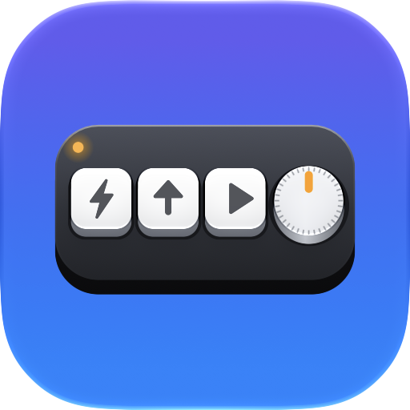

<h1 align="center">TinyDeck</h1>

<b>Your tiny macro pad, finally at home on Mac.</b> Program every key and knob of your USB mini keyboard. No Windows needed.

---

This repository hosts TinyDeck's **website, guides, press kit and issue tracker**. The app itself is available on the Mac App Store.

- 🌐 Website: https://amitsamant.dev/tinydeck/
- 📖 [Getting started](https://amitsamant.dev/tinydeck/docs/getting-started.html) · [Knob](https://amitsamant.dev/tinydeck/docs/knob.html) · [Lighting](https://amitsamant.dev/tinydeck/docs/lighting.html) · [Layers & files](https://amitsamant.dev/tinydeck/docs/layers-and-files.html) · [Troubleshooting](https://amitsamant.dev/tinydeck/docs/troubleshooting.html)
- ✅ [Compatible pads](https://amitsamant.dev/tinydeck/compatibility.html)
- 📰 [Press kit](https://amitsamant.dev/tinydeck/presskit/)
- 🔒 [Privacy policy](https://amitsamant.dev/tinydeck/privacy.html)

## Report your pad
Does TinyDeck work with your pad? In the app choose **Help ▸ Report My Pad**, or [open a pad report](https://github.com/DominatorVbN/tinydeck/issues/new?template=pad-report.yml).

## Credits
USB protocol based on [ch57x-keyboard-tool](https://github.com/kriomant/ch57x-keyboard-tool) by Mikhail Trishchenkov (MIT).
